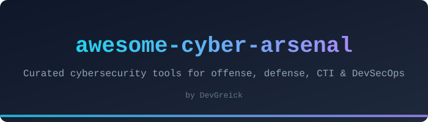

A curated list of awesome cybersecurity tools, frameworks, and resources across offensive, defensive, CTI, and DevSecOps domains.

Curated by [DevGreick](https://github.com/DevGreick)

---

## Contents

- [Offensive Security](#offensive-security)
  - [Reconnaissance](#reconnaissance)
  - [Vulnerability Scanning](#vulnerability-scanning)
  - [Exploitation Frameworks](#exploitation-frameworks)
  - [Post-Exploitation](#post-exploitation)
  - [Password Attacks](#password-attacks)
  - [Wireless](#wireless)
  - [Web Application](#web-application)
- [Defensive Security](#defensive-security)
  - [SIEM & Log Management](#siem--log-management)
  - [EDR & XDR](#edr--xdr)
  - [Firewall & Network Security](#firewall--network-security)
  - [Incident Response](#incident-response)
  - [Forensics](#forensics)
  - [Hardening](#hardening)
- [Cyber Threat Intelligence](#cyber-threat-intelligence)
  - [Threat Feeds & IOC](#threat-feeds--ioc)
  - [Threat Hunting](#threat-hunting)
  - [Malware Analysis](#malware-analysis)
  - [OSINT](#osint)
- [DevSecOps](#devsecops)
  - [SAST](#sast)
  - [DAST](#dast)
  - [SCA & Dependency Scanning](#sca--dependency-scanning)
  - [Container Security](#container-security)
  - [IaC Security](#iac-security)
  - [Secret Detection](#secret-detection)
  - [CI/CD Security](#cicd-security)
- [Cloud Security](#cloud-security)
  - [CSPM & Posture Management](#cspm--posture-management)
  - [Cloud Inventory & Visualization](#cloud-inventory--visualization)
  - [Kubernetes Security](#kubernetes-security)
  - [IAM & Identity](#iam--identity)
- [AI & ML Security](#ai--ml-security)
  - [LLM Red Teaming & Fuzzing](#llm-red-teaming--fuzzing)
  - [Guardrails & Runtime Protection](#guardrails--runtime-protection)
  - [Adversarial ML](#adversarial-ml)
  - [MCP & Agent Security](#mcp--agent-security)
- [Supply Chain Security](#supply-chain-security)
  - [SBOM Generation](#sbom-generation)
  - [SBOM Analysis & Vulnerability](#sbom-analysis--vulnerability)
  - [Build Provenance & Attestation](#build-provenance--attestation)
  - [Package Security](#package-security)
- [Mobile & IoT Security](#mobile--iot-security)
  - [Firmware Analysis](#firmware-analysis)
  - [Bluetooth & Wireless IoT](#bluetooth--wireless-iot)
  - [Mobile Application Security](#mobile-application-security)
  - [Automotive Security](#automotive-security)
- [Platforms & Dashboards](#platforms--dashboards)
- [Learning & CTF](#learning--ctf)
- [Contributing](#contributing)

---

> **Legend**
>
> | Badge | Meaning |
> |-------|---------|
> | 🟢 | Production-ready / Mature |
> | 🟡 | Beta / Active development |
> | 🔴 | Alpha / Experimental |
> | ⭐ | Tested by [DevGreick](https://github.com/DevGreick) |

---

## Offensive Security

### Reconnaissance

| Name | Description | Maturity | Link |
|------|-------------|----------|------|
| [Amass](https://owasp.org/www-project-amass/) | In-depth attack surface mapping and asset discovery | 🟢 | [GitHub](https://github.com/owasp-amass/amass) |
| [httpx](https://github.com/projectdiscovery/httpx) | Fast multi-purpose HTTP toolkit | 🟢 | [GitHub](https://github.com/projectdiscovery/httpx) |
| [Masscan](https://github.com/robertdavidgraham/masscan) | TCP port scanner that transmits 10M packets/sec | 🟢 | [GitHub](https://github.com/robertdavidgraham/masscan) |
| [Nmap](https://nmap.org/) | Network discovery and security auditing utility | 🟢 ⭐ | [GitHub](https://github.com/nmap/nmap) |
| [Recon-ng](https://github.com/lanmaster53/recon-ng) | Full-featured web reconnaissance framework | 🟢 | [GitHub](https://github.com/lanmaster53/recon-ng) |
| [Shodan](https://www.shodan.io/) | Search engine for internet-connected devices | 🟢⭐  | [Website](https://www.shodan.io/) |
| [Subfinder](https://projectdiscovery.io/) | Fast passive subdomain enumeration tool | 🟢⭐  |  [GitHub](https://github.com/projectdiscovery/subfinder) |
| [theHarvester](https://github.com/laramies/theHarvester) | E-mail, subdomain, and name harvester for OSINT | 🟢⭐  | [GitHub](https://github.com/laramies/theHarvester) |

### Vulnerability Scanning

| Name | Description | Maturity | Link |
|------|-------------|----------|------|
| [Nikto](https://cirt.net/Nikto2) | Web server scanner for dangerous files and outdated software | 🟢 | [GitHub](https://github.com/sullo/nikto) |
| [Nuclei](https://projectdiscovery.io/) | Fast vulnerability scanner based on templates | 🟢 ⭐ | [GitHub](https://github.com/projectdiscovery/nuclei) |
| [OpenVAS](https://www.openvas.org/) | Full-featured vulnerability scanner from Greenbone | 🟢 | [GitHub](https://github.com/greenbone/openvas-scanner) |
| [Trivy](https://aquasecurity.github.io/trivy/) | Comprehensive vulnerability scanner for containers, code, and IaC | 🟢 | [GitHub](https://github.com/aquasecurity/trivy) |

### Exploitation Frameworks

| Name | Description | Maturity | Link |
|------|-------------|----------|------|
| [Cobalt Strike](https://www.cobaltstrike.com/) | Commercial adversary simulation and red team operations | 🟢 | [Website](https://www.cobaltstrike.com/) |
| [Havoc](https://github.com/HavocFramework/Havoc) | Modern and malleable post-exploitation C2 framework | 🟡 | [GitHub](https://github.com/HavocFramework/Havoc) |
| [Metasploit](https://www.metasploit.com/) | The most widely used penetration testing framework | 🟢 ⭐ | [GitHub](https://github.com/rapid7/metasploit-framework) |
| [Sliver](https://github.com/BishopFox/sliver) | Open source cross-platform C2 framework | 🟢⭐  | [GitHub](https://github.com/BishopFox/sliver) |

### Post-Exploitation

| Name | Description | Maturity | Link |
|------|-------------|----------|------|
| [BloodHound](https://bloodhound.readthedocs.io/) | Active Directory attack path mapping using graph theory | 🟢⭐  | [GitHub](https://github.com/SpecterOps/BloodHound) |
| [CrackMapExec](https://github.com/byt3bl33d3r/CrackMapExec) | Post-exploitation tool for large Active Directory networks | 🟢 | [GitHub](https://github.com/byt3bl33d3r/CrackMapExec) |
| [Impacket](https://github.com/fortra/impacket) | Python classes for working with network protocols | 🟢 | [GitHub](https://github.com/fortra/impacket) |
| [Mimikatz](https://github.com/gentilkiwi/mimikatz) | Windows credential extraction and manipulation | 🟢 | [GitHub](https://github.com/gentilkiwi/mimikatz) |
| [Rubeus](https://github.com/GhostPack/Rubeus) | C# toolset for raw Kerberos interaction and abuse | 🟢 | [GitHub](https://github.com/GhostPack/Rubeus) |

### Password Attacks

| Name | Description | Maturity | Link |
|------|-------------|----------|------|
| [Hashcat](https://hashcat.net/hashcat/) | Advanced CPU/GPU-based password recovery | 🟢 ⭐ | [GitHub](https://github.com/hashcat/hashcat) |
| [Hydra](https://github.com/vanhauser-thc/thc-hydra) | Parallelized login cracker supporting numerous protocols | 🟢⭐  | [GitHub](https://github.com/vanhauser-thc/thc-hydra) |
| [John the Ripper](https://www.openwall.com/john/) | Open source password security auditing tool | 🟢 ⭐ | [GitHub](https://github.com/openwall/john) |

### Wireless

| Name | Description | Maturity | Link |
|------|-------------|----------|------|
| [Aircrack-ng](https://www.aircrack-ng.org/) | Complete suite for assessing WiFi network security | 🟢⭐  | [GitHub](https://github.com/aircrack-ng/aircrack-ng) |
| [Bettercap](https://www.bettercap.org/) | Swiss army knife for WiFi, BLE, and network recon/MITM | 🟢⭐  | [GitHub](https://github.com/bettercap/bettercap) |
| [Wifite2](https://github.com/derv82/wifite2) | Automated wireless attack tool | 🟢 | [GitHub](https://github.com/derv82/wifite2) |

### Web Application

| Name | Description | Maturity | Link |
|------|-------------|----------|------|
| [Burp Suite](https://portswigger.net/burp) | Industry-standard web vulnerability scanner and proxy | 🟢 ⭐ | [Website](https://portswigger.net/burp) |
| [Caido](https://caido.io/) | Lightweight web security auditing toolkit | 🟡 | [Website](https://caido.io/) |
| [ffuf](https://github.com/ffuf/ffuf) | Fast web fuzzer written in Go | 🟢 ⭐ | [GitHub](https://github.com/ffuf/ffuf) |
| [SQLMap](https://sqlmap.org/) | Automatic SQL injection and database takeover tool | 🟢 ⭐ | [GitHub](https://github.com/sqlmapproject/sqlmap) |
| [ZAP](https://www.zaproxy.org/) | Open source web app security scanner by OWASP | 🟢 | [GitHub](https://github.com/zaproxy/zaproxy) |

---

## Defensive Security

### SIEM & Log Management

| Name | Description | Maturity | Link |
|------|-------------|----------|------|
| [Elastic Security](https://www.elastic.co/security) | SIEM and security analytics on Elasticsearch | 🟢 | [GitHub](https://github.com/elastic/elasticsearch) |
| [Grafana Loki](https://grafana.com/oss/loki/) | Horizontally scalable multi-tenant log aggregation | 🟢 | [GitHub](https://github.com/grafana/loki) |
| [Graylog](https://graylog.org/) | Free and open log management platform | 🟢 | [GitHub](https://github.com/Graylog2/graylog2-server) |
| [Wazuh](https://wazuh.com/) | Open source unified XDR and SIEM protection | 🟢⭐  | [GitHub](https://github.com/wazuh/wazuh) |

### EDR & XDR

| Name | Description | Maturity | Link |
|------|-------------|----------|------|
| [LimaCharlie](https://limacharlie.io/) | SecOps cloud platform with EDR capabilities | 🟡 | [Website](https://limacharlie.io/) |
| [OSQuery](https://osquery.io/) | SQL-powered OS instrumentation and analytics | 🟢 | [GitHub](https://github.com/osquery/osquery) |
| [Velociraptor](https://docs.velociraptor.app/) | Endpoint visibility and collection tool for DFIR | 🟢 | [GitHub](https://github.com/Velocidex/velociraptor) |
| [Wazuh Agent](https://wazuh.com/) | Lightweight endpoint agent for threat detection | 🟢 | [GitHub](https://github.com/wazuh/wazuh) |

### Firewall & Network Security

| Name | Description | Maturity | Link |
|------|-------------|----------|------|
| [CrowdSec](https://www.crowdsec.net/) | Collaborative and open source IPS | 🟢 | [GitHub](https://github.com/crowdsecurity/crowdsec) |
| [pfSense](https://www.pfsense.org/) | Open source firewall/router distribution | 🟢 | [GitHub](https://github.com/pfsense/pfsense) |
| [Snort](https://www.snort.org/) | Open source intrusion prevention system | 🟢 | [GitHub](https://github.com/snort3/snort3) |
| [Suricata](https://suricata.io/) | High performance network IDS, IPS, and security monitoring | 🟢⭐  | [GitHub](https://github.com/OISF/suricata) |
| [Zeek](https://zeek.org/) | Powerful network analysis framework | 🟢 | [GitHub](https://github.com/zeek/zeek) |

### Incident Response

| Name | Description | Maturity | Link |
|------|-------------|----------|------|
| [DFIR-IRIS](https://dfir-iris.org/) | Collaborative incident response platform | 🟢 | [GitHub](https://github.com/dfir-iris/iris-web) |
| [GRR](https://github.com/google/grr) | Google's rapid response framework for remote live forensics | 🟢 | [GitHub](https://github.com/google/grr) |
| [TheHive](https://thehive-project.org/) | Scalable security incident response platform | 🟢 | [GitHub](https://github.com/TheHive-Project/TheHive) |

### Forensics

| Name | Description | Maturity | Link |
|------|-------------|----------|------|
| [Autopsy](https://www.autopsy.com/) | Digital forensics platform and GUI for The Sleuth Kit | 🟢 | [GitHub](https://github.com/sleuthkit/autopsy) |
| [Chainsaw](https://github.com/WithSecureLabs/chainsaw) | Rapidly search and hunt through Windows forensic artifacts | 🟢 | [GitHub](https://github.com/WithSecureLabs/chainsaw) |
| [Volatility3](https://github.com/volatilityfoundation/volatility3) | Advanced memory forensics framework | 🟢 | [GitHub](https://github.com/volatilityfoundation/volatility3) |
| [YARA](https://virustotal.github.io/yara/) | Pattern matching tool for malware researchers | 🟢 | [GitHub](https://github.com/VirusTotal/yara) |

### Hardening

| Name | Description | Maturity | Link |
|------|-------------|----------|------|
| [CIS Benchmarks](https://www.cisecurity.org/cis-benchmarks) | Consensus-based security configuration guides | 🟢 | [Website](https://www.cisecurity.org/cis-benchmarks) |
| [dev-sec.io](https://dev-sec.io/) | Automatic server hardening via Ansible/Chef/Puppet | 🟢 | [GitHub](https://github.com/dev-sec) |
| [Lynis](https://cisofy.com/lynis/) | Security auditing tool for Linux, macOS, and UNIX | 🟢 | [GitHub](https://github.com/CISOfy/lynis) |
| [OpenSCAP](https://www.open-scap.org/) | NIST-certified security compliance toolkit | 🟢 | [GitHub](https://github.com/OpenSCAP/openscap) |

---

## Cyber Threat Intelligence

### Threat Feeds & IOC

| Name | Description | Maturity | Link |
|------|-------------|----------|------|
| [Abuse.ch](https://abuse.ch/) | Community-driven threat intelligence on malware and botnets | 🟢⭐  | [Website](https://abuse.ch/) |
| [AlienVault OTX](https://otx.alienvault.com/) | Open threat exchange with community-driven threat data | 🟢 | [Website](https://otx.alienvault.com/) |
| [IntelOwl](https://github.com/intelowlproject/IntelOwl) | Analyze files, domains, IPs via multiple sources at once | 🟢 | [GitHub](https://github.com/intelowlproject/IntelOwl) |
| [MISP](https://www.misp-project.org/) | Open source threat intelligence and sharing platform | 🟢⭐  | [GitHub](https://github.com/MISP/MISP) |
| [OpenCTI](https://www.opencti.io/) | Open source platform for cyber threat intelligence management | 🟢⭐  | [GitHub](https://github.com/OpenCTI-Platform/opencti) |
| [ThreatDeflect](https://github.com/DevGreick/ThreatDeflect) | Hybrid Python+Rust IOC analysis with local AI guardrails and GUI | 🟡 ⭐ | [GitHub](https://github.com/DevGreick/ThreatDeflect) |

### Threat Hunting

| Name | Description | Maturity | Link |
|------|-------------|----------|------|
| [Elastic Detection Rules](https://github.com/elastic/detection-rules) | Community detection rules for Elastic Security | 🟢 | [GitHub](https://github.com/elastic/detection-rules) |
| [MITRE ATT&CK](https://attack.mitre.org/) | Knowledge base of adversary tactics and techniques | 🟢⭐  | [Website](https://attack.mitre.org/) |
| [Sigma](https://sigmahq.io/) | Generic and open signature format for SIEM systems | 🟢 | [GitHub](https://github.com/SigmaHQ/sigma) |
| [YARA Rules](https://github.com/Yara-Rules/rules) | Community repository of YARA rules | 🟢 | [GitHub](https://github.com/Yara-Rules/rules) |

### Malware Analysis

| Name | Description | Maturity | Link |
|------|-------------|----------|------|
| [ANY.RUN](https://any.run/) | Interactive malware hunting sandbox | 🟢 | [Website](https://any.run/) |
| [CAPE](https://github.com/kevoreilly/CAPEv2) | Malware Configuration And Payload Extraction | 🟢 | [GitHub](https://github.com/kevoreilly/CAPEv2) |
| [Cutter](https://cutter.re/) | Free and open source RE platform powered by Rizin | 🟢 | [GitHub](https://github.com/rizinorg/cutter) |
| [Ghidra](https://ghidra-sre.org/) | NSA's software reverse engineering framework | 🟢 | [GitHub](https://github.com/NationalSecurityAgency/ghidra) |
| [MobSF](https://github.com/MobSF/Mobile-Security-Framework-MobSF) | Automated mobile app security testing framework | 🟢 ⭐ | [GitHub](https://github.com/MobSF/Mobile-Security-Framework-MobSF) |

### OSINT

| Name | Description | Maturity | Link |
|------|-------------|----------|------|
| [Maigret](https://github.com/soxoj/maigret) | Collect a dossier on a person by username from thousands of sites | 🟢 | [GitHub](https://github.com/soxoj/maigret) |
| [Maltego](https://www.maltego.com/) | Interactive data mining and link analysis | 🟢⭐  | [Website](https://www.maltego.com/) |
| [Sherlock](https://github.com/sherlock-project/sherlock) | Hunt down social media accounts by username | 🟢⭐  | [GitHub](https://github.com/sherlock-project/sherlock) |
| [SpiderFoot](https://www.spiderfoot.net/) | Automated OSINT collection and reconnaissance | 🟢 | [GitHub](https://github.com/smicallef/spiderfoot) |

---

## DevSecOps

### SAST

| Name | Description | Maturity | Link |
|------|-------------|----------|------|
| [Bandit](https://bandit.readthedocs.io/) | Security linter for Python code | 🟢 ⭐ | [GitHub](https://github.com/PyCQA/bandit) |
| [cargo-audit](https://github.com/rustsec/rustsec) | Audit Cargo.lock for crates with security vulnerabilities | 🟢 ⭐ | [GitHub](https://github.com/rustsec/rustsec) |
| [Semgrep](https://semgrep.dev/) | Lightweight static analysis with custom rules | 🟢 ⭐ | [GitHub](https://github.com/semgrep/semgrep) |
| [SonarQube](https://www.sonarsource.com/products/sonarqube/) | Continuous code quality and security inspection | 🟢 | [GitHub](https://github.com/SonarSource/sonarqube) |

### DAST

| Name | Description | Maturity | Link |
|------|-------------|----------|------|
| [Dastardly](https://portswigger.net/burp/dastardly) | Free CI/CD DAST scanner from PortSwigger | 🟢 | [Website](https://portswigger.net/burp/dastardly) |
| [Nuclei](https://projectdiscovery.io/) | Fast and customizable vulnerability scanner | 🟢 ⭐ | [GitHub](https://github.com/projectdiscovery/nuclei) |
| [ZAP](https://www.zaproxy.org/) | Open source web app security scanner by OWASP | 🟢 | [GitHub](https://github.com/zaproxy/zaproxy) |

### SCA & Dependency Scanning

| Name | Description | Maturity | Link |
|------|-------------|----------|------|
| [Dependabot](https://github.com/dependabot) | Automated dependency updates for GitHub repos | 🟢 | [GitHub](https://github.com/dependabot) |
| [Grype](https://github.com/anchore/grype) | Vulnerability scanner for container images and filesystems | 🟢 | [GitHub](https://github.com/anchore/grype) |
| [OSV-Scanner](https://google.github.io/osv-scanner/) | Vulnerability scanner for project dependencies using OSV.dev | 🟢 | [GitHub](https://github.com/google/osv-scanner) |
| [Snyk](https://snyk.io/) | Developer security platform for dependencies and code | 🟢 | [Website](https://snyk.io/) |

### Container Security

| Name | Description | Maturity | Link |
|------|-------------|----------|------|
| [Cosign](https://github.com/sigstore/cosign) | Container signing, verification, and provenance | 🟢 | [GitHub](https://github.com/sigstore/cosign) |
| [Docker Bench](https://github.com/docker/docker-bench-security) | CIS Docker Benchmark script | 🟢 | [GitHub](https://github.com/docker/docker-bench-security) |
| [Falco](https://falco.org/) | Cloud native runtime security and threat detection | 🟢 | [GitHub](https://github.com/falcosecurity/falco) |
| [Trivy](https://aquasecurity.github.io/trivy/) | All-in-one security scanner for containers and more | 🟢 | [GitHub](https://github.com/aquasecurity/trivy) |

### IaC Security

| Name | Description | Maturity | Link |
|------|-------------|----------|------|
| [Checkov](https://www.checkov.io/) | Static analysis for IaC (Terraform, CloudFormation, K8s) | 🟢 | [GitHub](https://github.com/bridgecrewio/checkov) |
| [KICS](https://kics.io/) | Find security issues in IaC and keep infrastructure secure | 🟢 | [GitHub](https://github.com/Checkmarx/kics) |
| [tfsec](https://aquasecurity.github.io/tfsec/) | Security scanner for Terraform code | 🟢 | [GitHub](https://github.com/aquasecurity/tfsec) |

### Secret Detection

| Name | Description | Maturity | Link |
|------|-------------|----------|------|
| [detect-secrets](https://github.com/Yelp/detect-secrets) | Auditing tool to detect secrets within a codebase | 🟢 | [GitHub](https://github.com/Yelp/detect-secrets) |
| [Gitleaks](https://gitleaks.io/) | Protect and discover secrets in git repos | 🟢 ⭐ | [GitHub](https://github.com/gitleaks/gitleaks) |
| [TruffleHog](https://trufflesecurity.com/) | Find and verify leaked credentials | 🟢 ⭐ | [GitHub](https://github.com/trufflesecurity/trufflehog) |

### CI/CD Security

| Name | Description | Maturity | Link |
|------|-------------|----------|------|
| [Allstar](https://github.com/ossf/allstar) | GitHub App for enforcing security best practices | 🟢 | [GitHub](https://github.com/ossf/allstar) |
| [Scorecard](https://securityscorecards.dev/) | OpenSSF security health metrics for open source projects | 🟢 | [GitHub](https://github.com/ossf/scorecard) |
| [Step Security](https://www.stepsecurity.io/) | Harden CI/CD pipelines with automated fixes | 🟢 | [GitHub](https://github.com/step-security/harden-runner) |

---

## Cloud Security

### CSPM & Posture Management

| Name | Description | Maturity | Link |
|------|-------------|----------|------|
| [CloudSploit](https://github.com/aquasecurity/cloudsploit) | Cloud security config checks for AWS, Azure, GCP, and OCI | 🟢 | [GitHub](https://github.com/aquasecurity/cloudsploit) |
| [Prowler](https://prowler.com/) | Cloud security platform for AWS, Azure, GCP, and K8s posture | 🟢 | [GitHub](https://github.com/prowler-cloud/prowler) |
| [Scout Suite](https://github.com/nccgroup/ScoutSuite) | Multi-cloud security auditing tool by NCC Group | 🟢 | [GitHub](https://github.com/nccgroup/ScoutSuite) |

### Cloud Inventory & Visualization

| Name | Description | Maturity | Link |
|------|-------------|----------|------|
| [Cartography](https://github.com/lyft/cartography) | Infrastructure asset mapping via Neo4j graph database | 🟢 | [GitHub](https://github.com/lyft/cartography) |
| [Cloud Custodian](https://cloudcustodian.io/) | Rules engine for cloud security, cost, and governance policies | 🟢 | [GitHub](https://github.com/cloud-custodian/cloud-custodian) |
| [CloudQuery](https://www.cloudquery.io/) | Cloud asset inventory as SQL-queryable tables | 🟢 | [GitHub](https://github.com/cloudquery/cloudquery) |
| [Steampipe](https://steampipe.io/) | SQL queries against live cloud APIs from 500+ data sources | 🟢 | [GitHub](https://github.com/turbot/steampipe) |

### Kubernetes Security

| Name | Description | Maturity | Link |
|------|-------------|----------|------|
| [Falco](https://falco.org/) | Cloud native runtime security and threat detection for K8s | 🟢 | [GitHub](https://github.com/falcosecurity/falco) |
| [Kube-bench](https://github.com/aquasecurity/kube-bench) | CIS Kubernetes Benchmark checks | 🟢 | [GitHub](https://github.com/aquasecurity/kube-bench) |
| [KubeArmor](https://kubearmor.io/) | Runtime security enforcement for K8s and cloud workloads | 🟢 | [GitHub](https://github.com/kubearmor/KubeArmor) |
| [Kubescape](https://kubescape.io/) | Kubernetes security platform with NSA/MITRE framework checks | 🟢 | [GitHub](https://github.com/kubescape/kubescape) |
| [Kyverno](https://kyverno.io/) | Policy engine for Kubernetes admission control and validation | 🟢 | [GitHub](https://github.com/kyverno/kyverno) |

### IAM & Identity

| Name | Description | Maturity | Link |
|------|-------------|----------|------|
| [AirIAM](https://github.com/bridgecrewio/AirIAM) | AWS IAM least-privilege migration to Terraform | 🟢 | [GitHub](https://github.com/bridgecrewio/AirIAM) |
| [Cloudsplaining](https://github.com/salesforce/cloudsplaining) | AWS IAM security assessment for least privilege violations | 🟢 | [GitHub](https://github.com/salesforce/cloudsplaining) |
| [Pacu](https://github.com/RhinoSecurityLabs/pacu) | AWS exploitation framework for offensive security testing | 🟢 | [GitHub](https://github.com/RhinoSecurityLabs/pacu) |

---

## AI & ML Security

### LLM Red Teaming & Fuzzing

| Name | Description | Maturity | Link |
|------|-------------|----------|------|
| [Garak](https://github.com/NVIDIA/garak) | NVIDIA's LLM vulnerability scanner with 50+ probe families | 🟢 | [GitHub](https://github.com/NVIDIA/garak) |
| [Giskard](https://github.com/Giskard-AI/giskard) | Testing and evaluation framework for ML and LLM models | 🟢 | [GitHub](https://github.com/Giskard-AI/giskard) |
| [Promptfoo](https://www.promptfoo.dev/) | LLM red teaming, pentesting, and vulnerability scanning | 🟢 | [GitHub](https://github.com/promptfoo/promptfoo) |
| [Purple Llama](https://github.com/meta-llama/PurpleLlama) | Meta's tools for assessing and improving LLM security | 🟢 | [GitHub](https://github.com/meta-llama/PurpleLlama) |
| [PyRIT](https://github.com/Azure/PyRIT) | Microsoft's Python Risk Identification Tool for generative AI | 🟢 | [GitHub](https://github.com/Azure/PyRIT) |

### Guardrails & Runtime Protection

| Name | Description | Maturity | Link |
|------|-------------|----------|------|
| [LLM Guard](https://protectai.com/llm-guard) | Input/output scanning for prompt injection, PII, and toxicity | 🟢 | [GitHub](https://github.com/protectai/llm-guard) |
| [NeMo Guardrails](https://github.com/NVIDIA/NeMo-Guardrails) | NVIDIA's programmable guardrails for LLM conversations | 🟢 | [GitHub](https://github.com/NVIDIA/NeMo-Guardrails) |
| [Rebuff](https://github.com/protectai/rebuff) | Self-hardening prompt injection detector with canary tokens | 🟡 | [GitHub](https://github.com/protectai/rebuff) |
| [Vigil](https://github.com/deadbits/vigil-llm) | Detect prompt injections and jailbreaks via heuristics + YARA | 🟡 | [GitHub](https://github.com/deadbits/vigil-llm) |

### Adversarial ML

| Name | Description | Maturity | Link |
|------|-------------|----------|------|
| [ART](https://github.com/Trusted-AI/adversarial-robustness-toolbox) | IBM's Adversarial Robustness Toolbox for evasion and poisoning | 🟢 | [GitHub](https://github.com/Trusted-AI/adversarial-robustness-toolbox) |
| [Counterfit](https://github.com/Azure/counterfit) | Microsoft's CLI for assessing ML model security | 🟡 | [GitHub](https://github.com/Azure/counterfit) |
| [Foolbox](https://github.com/bethgelab/foolbox) | Adversarial attacks against neural networks in PyTorch/TF/JAX | 🟢 | [GitHub](https://github.com/bethgelab/foolbox) |
| [TextAttack](https://github.com/QData/TextAttack) | Framework for adversarial attacks and data augmentation in NLP | 🟢 | [GitHub](https://github.com/QData/TextAttack) |

### MCP & Agent Security

| Name | Description | Maturity | Link |
|------|-------------|----------|------|
| [Agentic Radar](https://github.com/splx-ai/agentic-radar) | CLI security scanner for agentic AI workflows | 🟡 | [GitHub](https://github.com/splx-ai/agentic-radar) |
| [MCP Guardian](https://github.com/eqtylab/mcp-guardian) | Access control and activity monitoring for MCP servers | 🟡 | [GitHub](https://github.com/eqtylab/mcp-guardian) |
| [ModelScan](https://github.com/protectai/modelscan) | Security scanner for serialized ML model files | 🟢 | [GitHub](https://github.com/protectai/modelscan) |

---

## Supply Chain Security

### SBOM Generation

| Name | Description | Maturity | Link |
|------|-------------|----------|------|
| [SBOM Tool](https://github.com/microsoft/sbom-tool) | Microsoft's SBOM generator for build-time artifact analysis | 🟢 | [GitHub](https://github.com/microsoft/sbom-tool) |
| [Syft](https://github.com/anchore/syft) | CLI tool for generating SBOMs from containers and filesystems | 🟢 | [GitHub](https://github.com/anchore/syft) |
| [Tern](https://github.com/terntools/tern) | SBOM tool for container images focused on package metadata | 🟢 | [GitHub](https://github.com/terntools/tern) |

### SBOM Analysis & Vulnerability

| Name | Description | Maturity | Link |
|------|-------------|----------|------|
| [Bomber](https://github.com/devops-kung-fu/bomber) | Scan SBOMs for security vulnerabilities across multiple feeds | 🟢 | [GitHub](https://github.com/devops-kung-fu/bomber) |
| [Dependency-Track](https://dependencytrack.org/) | Intelligent component analysis platform for SBOM consumption | 🟢 | [GitHub](https://github.com/DependencyTrack/dependency-track) |
| [Grype](https://github.com/anchore/grype) | Vulnerability scanner for container images and filesystems | 🟢 | [GitHub](https://github.com/anchore/grype) |

### Build Provenance & Attestation

| Name | Description | Maturity | Link |
|------|-------------|----------|------|
| [in-toto](https://in-toto.io/) | Framework to secure the integrity of software supply chains | 🟢 | [GitHub](https://github.com/in-toto/in-toto) |
| [Sigstore](https://www.sigstore.dev/) | Keyless signing and verification for software artifacts | 🟢 | [GitHub](https://github.com/sigstore/sigstore) |
| [SLSA](https://slsa.dev/) | Supply-chain Levels for Software Artifacts security framework | 🟢 | [Website](https://slsa.dev/) |
| [Witness](https://github.com/in-toto/witness) | Pluggable framework for supply chain risk management | 🟢 | [GitHub](https://github.com/in-toto/witness) |

### Package Security

| Name | Description | Maturity | Link |
|------|-------------|----------|------|
| [Chainloop](https://chainloop.dev/) | Evidence store and policy engine for supply chain attestations | 🟢 | [GitHub](https://github.com/chainloop-dev/chainloop) |
| [Socket](https://socket.dev/) | Detect malicious behavior in open source packages at runtime | 🟢 | [Website](https://socket.dev/) |

---

## Mobile & IoT Security

### Firmware Analysis

| Name | Description | Maturity | Link |
|------|-------------|----------|------|
| [Binwalk](https://github.com/ReFirmLabs/binwalk) | Firmware extraction and reverse engineering tool | 🟢 | [GitHub](https://github.com/ReFirmLabs/binwalk) |
| [EMBA](https://github.com/e-m-b-a/emba) | Linux-based firmware security analyzer for embedded devices | 🟢 | [GitHub](https://github.com/e-m-b-a/emba) |
| [FACT](https://fkie-cad.github.io/FACT_core/) | Firmware Analysis and Comparison Tool with web UI and plugins | 🟢 | [GitHub](https://github.com/fkie-cad/FACT_core) |
| [Firmadyne](https://github.com/firmadyne/firmadyne) | Platform for firmware emulation and dynamic analysis | 🟢 | [GitHub](https://github.com/firmadyne/firmadyne) |
| [FwAnalyzer](https://github.com/cruise-automation/fwanalyzer) | Firmware security analysis with customizable rules for DevSecOps | 🟢 | [GitHub](https://github.com/cruise-automation/fwanalyzer) |
| [Unblob](https://unblob.org/) | Accurate and fast firmware extraction for 30+ formats | 🟢 | [GitHub](https://github.com/onekey-sec/unblob) |

### Bluetooth & Wireless IoT

| Name | Description | Maturity | Link |
|------|-------------|----------|------|
| [BlueToolkit](https://github.com/sgxgsx/BlueToolkit) | Modular Bluetooth Classic/BLE security testing framework | 🟡 | [GitHub](https://github.com/sgxgsx/BlueToolkit) |
| [Btlejack](https://github.com/virtualabs/btlejack) | BLE sniffing, jamming, and hijacking tool | 🟢 | [GitHub](https://github.com/virtualabs/btlejack) |
| [Killerbee](https://github.com/riverloopsec/killerbee) | IEEE 802.15.4/ZigBee security research framework | 🟢 | [GitHub](https://github.com/riverloopsec/killerbee) |
| [Sniffle](https://github.com/nccgroup/Sniffle) | Bluetooth 5 and 4.x LE sniffer using TI CC1352/CC26x2 | 🟢 | [GitHub](https://github.com/nccgroup/Sniffle) |

### Mobile Application Security

| Name | Description | Maturity | Link |
|------|-------------|----------|------|
| [Frida](https://frida.re/) | Dynamic instrumentation toolkit for apps on any platform | 🟢 ⭐ | [GitHub](https://github.com/frida/frida) |
| [MobSF](https://github.com/MobSF/Mobile-Security-Framework-MobSF) | Automated mobile app pen-testing framework (Android/iOS) | 🟢 ⭐ | [GitHub](https://github.com/MobSF/Mobile-Security-Framework-MobSF) |
| [Objection](https://github.com/sensepost/objection) | Runtime mobile exploration toolkit powered by Frida | 🟢 | [GitHub](https://github.com/sensepost/objection) |

### Automotive Security

| Name | Description | Maturity | Link |
|------|-------------|----------|------|
| [CANtool](https://github.com/AustriaCoder/CANtool) | CAN bus analysis and fuzzing tool | 🟡 | [GitHub](https://github.com/AustriaCoder/CANtool) |
| [ICSim](https://github.com/zombieCraig/ICSim) | Instrument Cluster Simulator for CAN bus security research | 🟢 | [GitHub](https://github.com/zombieCraig/ICSim) |
| [SavvyCAN](https://www.savvycan.com/) | Cross-platform CAN bus reverse engineering and capture tool | 🟢 | [GitHub](https://github.com/collin80/SavvyCAN) |

---

## Platforms & Dashboards

| Name | Description | Maturity | Link |
|------|-------------|----------|------|
| [Cortex XSOAR](https://www.paloaltonetworks.com/cortex/cortex-xsoar) | Security orchestration, automation, and response by Palo Alto | 🟢 | [Website](https://www.paloaltonetworks.com/cortex/cortex-xsoar) |
| [DefectDojo](https://www.defectdojo.com/) | Application vulnerability correlation and security orchestration | 🟢 | [GitHub](https://github.com/DefectDojo/django-DefectDojo) |
| [Security Onion](https://securityonionsolutions.com/) | Free and open platform for threat hunting and log management | 🟢 | [GitHub](https://github.com/Security-Onion-Solutions/securityonion) |
| [Shuffle](https://shuffler.io/) | Open source SOAR platform for security orchestration | 🟢 | [GitHub](https://github.com/Shuffle/Shuffle) |

---

## Learning & CTF

| Name | Description | Maturity | Link |
|------|-------------|----------|------|
| [CyberDefenders](https://cyberdefenders.org/) | Blue team training platform with real-world scenarios | 🟢⭐  | [Website](https://cyberdefenders.org/) |
| [HackTheBox](https://www.hackthebox.com/) | Online cybersecurity training platform with labs | 🟢⭐  | [Website](https://www.hackthebox.com/) |
| [PicoCTF](https://picoctf.org/) | Free computer security education program with CTF challenges | 🟢⭐  | [Website](https://picoctf.org/) |
| [PortSwigger Academy](https://portswigger.net/web-security) | Free web security training from Burp Suite creators | 🟢⭐  | [Website](https://portswigger.net/web-security) |
| [SANS Cyber Ranges](https://www.sans.org/cyber-ranges/) | Premium hands-on cybersecurity exercises | 🟢⭐  | [Website](https://www.sans.org/cyber-ranges/) |
| [TryHackMe](https://tryhackme.com/) | Hands-on cyber security training through real-world scenarios | 🟢⭐  | [Website](https://tryhackme.com/) |
| [VulnHub](https://www.vulnhub.com/) | Vulnerable VMs for hands-on security experience | 🟢⭐  | [Website](https://www.vulnhub.com/) |

---

## Contributing

Contributions are welcome! Please read the [Contributing Guide](CONTRIBUTING.md) before submitting a PR.

## License

[MIT](LICENSE)
